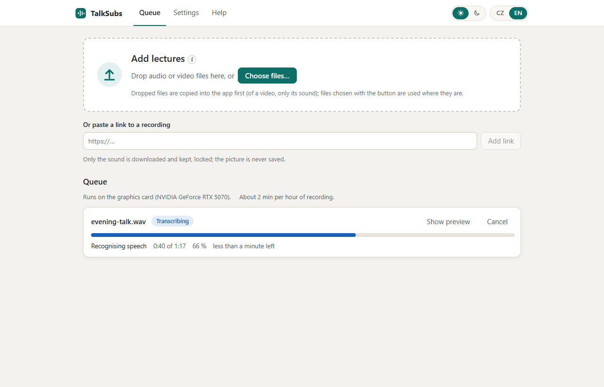
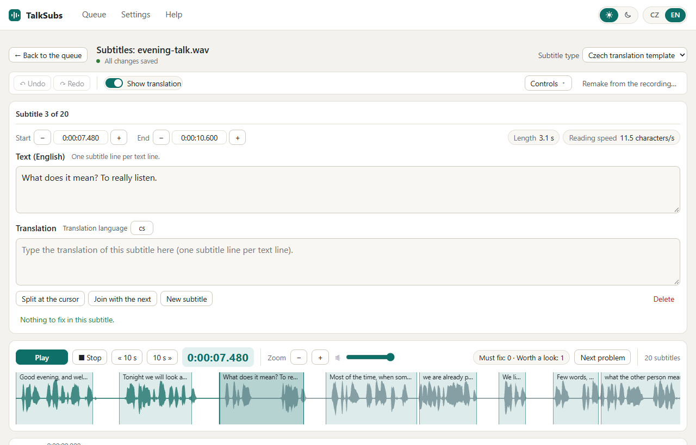
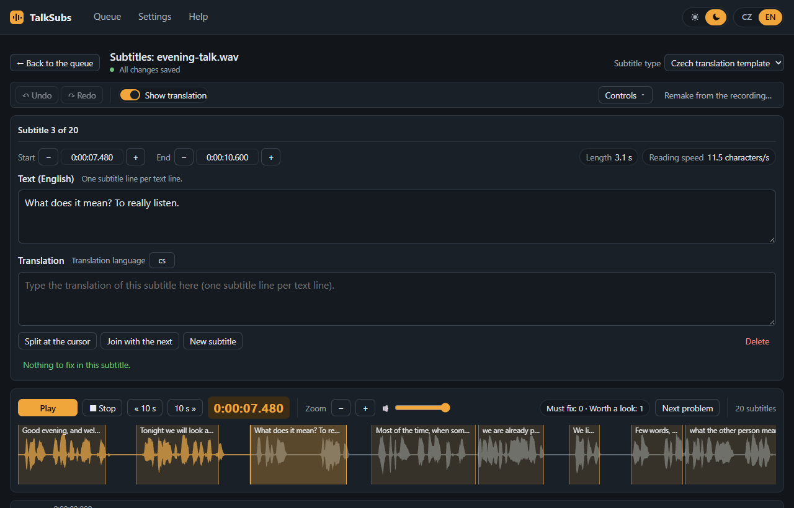
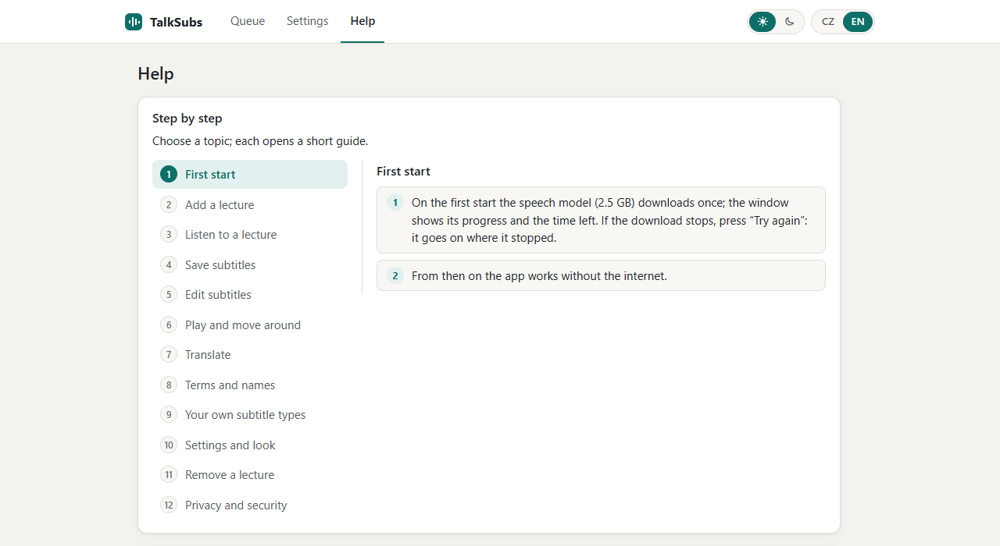

# TalkSubs

**Timed English subtitles from lecture recordings, made entirely on your own Windows PC.**

TalkSubs turns English audio or video (lectures, talks, courses) into a subtitle template that a translator can
work from, or into finished English subtitles. Every word is timed by a modern speech model, the subtitles follow
professional rules for length and reading speed, and a built-in editor lets you check and correct them while you
listen. Nothing is uploaded: after a one-time model download it works offline.

[](https://github.com/Martin8O/talksubs/releases/latest)

[](LICENSE)



## Contents
- [Features](#features)
- [Step-by-step guide](docs/guide.md) ([česky](docs/navod.md))
- [Download and run](#download-and-run)
- [Requirements](#requirements)
- [How it works](#how-it-works)
- [Privacy and security](#privacy-and-security)
- [Subtitle rules](#subtitle-rules)
- [Building from source](#building-from-source)
- [Credits](#credits)
- [Licence](#licence)

## Features
- **Add lectures your way:** the Windows file dialog, drag and drop, or a pasted download link. Of a video only
  the sound is kept.
- **Fast and accurate:** NVIDIA Parakeet TDT 0.6B v2 times every word, with speech detection in front of it. On
  silence or noise it writes nothing rather than inventing text. A 2 h 15 min lecture takes about 1.5–2.5 minutes
  on an RTX 5070, or about 2 minutes per hour of recording on a modern desktop processor.
- **Two kinds of subtitles at once:** a translation template (shorter and slower to read, leaving room for a longer
  translation) and finished English subtitles.
- **Every common format:** SRT, WebVTT, ASS, timecoded text, and an Excel sheet with a Translation column
  (filled where you translated in the editor).
  Export again with other choices at any time, without transcribing again.
- **Subtitle editor:** a player with stop, 10-second jumps and a large position clock, and a waveform where you drag
  subtitle edges or type their times; split, join, insert, delete and nudge by one frame; live rule warnings, undo
  and redo, keyboard shortcuts and automatic saving.
- **Terms and names:** a built-in list puts right the terms the speech model tends to misspell; add your own in
  Settings, one per line.
- **Long recordings:** lectures of 3–5 hours and more. A transcription that is interrupted (the app closed, a crash,
  a full graphics card, a full disk) goes on where it stopped, with the same result.
- **Clear progress:** live progress and a time estimate for every lecture in the queue, and a cancel button.
- **Translate in the editor:** a column beside the English subtitles for their translation, with live line length
  and reading speed; the translation is saved as its own subtitle files (and in the Excel table).
- **Your own subtitle types:** start from a published guideline (Netflix-style, TED-style, the Czech translators'
  guidelines and more) or a copy, and set line length, reading speed, timing and how strict each rule is.
- **Interface:** English or Czech, light or dark, with a Help page and a
  [step-by-step guide](docs/guide.md) ([česky](docs/navod.md)).



## Download and run
1. Download `TalkSubs-<version>-windows-x64.zip` from the
   [latest release](https://github.com/Martin8O/talksubs/releases/latest).
2. Unzip it to a folder you can write to, for example `C:\TalkSubs` or a folder on another drive. Avoid Program
   Files and folders that OneDrive synchronises (often Documents and Desktop): the app keeps its work and the 2.5 GB
   speech model inside its own folder.
3. Double-click `TalkSubs.bat`. Windows may warn about a file from the internet: choose "More info" and
   "Run anyway" (or, before unzipping, right-click the zip, open Properties and tick "Unblock").

On the first start the speech model is downloaded once (2.5 GB), with its progress in the window. An interrupted
download goes on where it stopped, and every file is checked against the exact version the app was tested with.

The download package runs the speech model on the processor, so it works on any PC; it brings its own Python
runtime and FFmpeg and needs no installation. If Microsoft's Visual C++ runtime is missing, `TalkSubs.bat` says so
and gives the download link.

**NVIDIA graphics card:** on a PC with a usable NVIDIA card (6 GB of memory or more, a driver from CUDA 12 on) the
window offers to download its support once: 1.7 GB of NVIDIA's official CUDA and cuDNN libraries and the matching
ONNX Runtime, each from its PyPI package and checked against a pinned SHA-256. Transcription then runs on the card,
about twice as fast, more on a PC with a slower processor; the very first run on the card takes longer while it
prepares. The download goes on where it stopped after an interruption; until it is in, and on any other PC, the app
works on the processor. A damaged support file is noticed when the app loads it: the app goes back to the processor
and the window offers the download again. The support lives in the `card` folder inside the app's folder; to remove
it, close the app and delete that folder.

## Requirements
- Windows 10 or 11, 64-bit.
- A Chromium-based browser for the app window: Edge (part of Windows), Chrome or Brave.
- On the processor: about 3.3 GB of memory while transcribing.
- On an NVIDIA graphics card (with its support downloaded, or from source): 6 GB of card memory or more; developed
  on a 12 GB card, where a 2-hour lecture peaks at about 5.4 GB.
- About 3 GB of disk space for the app and its model, plus room for your recordings; the graphics-card support
  adds 2.6 GB (about 4.5 GB must be free while it is downloaded and unpacked).
- The app keeps 1 GB free on the drive of its folder for its own work: a dropped file is copied in only when that
  much stays free after the copy.

## How it works
1. The sound is taken from the recording and turned into one steady format; of a video only the sound is used.
2. Speech detection ([Silero VAD](https://github.com/snakers4/silero-vad)) finds where someone speaks and skips
   silence, music and noise, so nothing is invented there.
3. The speech model (NVIDIA Parakeet TDT 0.6B v2) writes every word with the moment it starts and ends.
4. Terms and names the model tends to misspell are put right, from the built-in list and your own list.
5. The words are cut into subtitles by the chosen preset: length, lines, reading speed, gaps and good line breaks.
6. A rule checker marks anything that breaks a rule; the editor shows it and lets you fix it.

## Privacy and security
**What is processed where**
- Everything is processed on your own computer: the sound, the speech recognition, the subtitles and the editor.
- Nothing is uploaded. There is no account, no statistics and no tracking.
- The internet is used in these cases only: once on the first start, to download the speech model from Hugging
  Face; when you paste a link, to download that recording (of a video only the sound is kept; the picture is never
  saved); and once, if you ask for it, to download the support for an NVIDIA graphics card from PyPI.

**Encryption: what the app keeps is locked**
- Everything the app keeps for itself (transcripts, subtitle drafts, the sound from links, copies of dropped files,
  the listening copies, the queue and settings) is encrypted with AES-256-GCM: one random 256-bit key per data
  folder, a separate key per file derived from it, and every file sealed in authenticated chunks, so a damaged,
  cut or swapped file is refused rather than read wrongly.
- The key is locked to your Windows account with Windows DPAPI. Another account on the same PC, a copied, synced or
  backed-up folder, a stolen disk, or a program that just reads files cannot read your work.
- If your Windows sign-in is lost (a reset password, a new account, a reinstalled system), the work kept in the app
  is lost too. Saved subtitle files are not affected.
- Encryption cannot protect against a harmful program running under your own Windows account; no app can.

**Who can reach the app**
- The app listens only on this computer (127.0.0.1), never on the network.
- It answers only programs of the Windows account that started it, not other accounts signed in on the same PC, and
  it refuses requests from other web pages open in a browser.
- Its folders are readable by your account only.

**What is never written down**
- The secret part of a pasted link is never shown, logged or put in a message.
- The app's log never names your files.
- The app's window keeps no copies of transcripts or recordings.

**What is deleted, and when**
- Remove (on a finished lecture) asks first, says what will happen, and then deletes for good the transcript, your
  edits and the listening copy, together with the sound downloaded from a link or the copy of a dropped file.
- Your own original files and every subtitle file you saved are never deleted by the app.
- Saved subtitle files are ordinary, unencrypted files in the folder you choose, so other programs can use them.



## Subtitle rules
| | Translation template | English subtitles |
|---|---|---|
| Reading speed | up to 17 characters per second | up to 20 characters per second |
| Lines | at most 2 × 42 characters | at most 2 × 42 characters |
| Duration | 1–7 seconds | 1–7 seconds |
| Gap between subtitles | at least 2 frames | at least 2 frames |

Both keep good line breaks (never between an article and its noun, or a first and a last name), and a rule checker
lists anything that breaks a rule. The rules are data in `presets/`, so another preset needs no code.

## Building from source
Needs Python 3.11, [uv](https://docs.astral.sh/uv/) and FFmpeg on PATH. In PowerShell:
```powershell
. .\scripts\env.ps1      # keeps every cache and model inside the application folder
uv sync                  # creates .venv with the pinned libraries (graphics-card build)
.\scripts\doctor.ps1     # checks the environment and says where the model will run
```
Then double-click `TalkSubs.bat`.

Command line, without the window:
```powershell
.venv\Scripts\python.exe -m parakeet_stt transcribe <file> -o <folder> --preset all --format all
```

Other tools:
- `.\scripts\gate.ps1`: the quality gate (lint, types, all tests). Its accuracy tests need evaluation recordings
  that are not published (`data/eval/lecture-a.wav` with a checked reference text); without them it reports those
  tests as missing.
- `.venv\Scripts\python.exe scripts\build_package.py`: builds the download package from a commit.
- `.venv\Scripts\python.exe scripts\readme_pictures.py`: makes the pictures in this README again, from a neutral
  spoken sample.

More: [architecture](docs/architecture.md), [extending](docs/extending.md) (engines, formats, presets) and the
[decision record](docs/adr.md).

## Credits
- Speech recognition: [NVIDIA Parakeet TDT 0.6B v2](https://huggingface.co/nvidia/parakeet-tdt-0.6b-v2) by NVIDIA,
  licensed [CC BY 4.0](https://creativecommons.org/licenses/by/4.0/), in its
  [ONNX conversion](https://huggingface.co/istupakov/parakeet-tdt-0.6b-v2-onnx) by istupakov, used as it is.
- Speech detection: [Silero VAD](https://github.com/snakers4/silero-vad) by Silero Team (MIT licence), in its
  [ONNX version](https://huggingface.co/istupakov/silero-vad-onnx) by istupakov.
- Both models are downloaded on the first start, not shipped with the app; the Help page in the app credits them too.
- The graphics-card support is not shipped either: on request the app downloads NVIDIA's CUDA runtime, cuBLAS, cuFFT,
  NVRTC and cuDNN libraries and ONNX Runtime from their official PyPI packages; they stay under their own licence
  terms (NVIDIA's, and MIT for ONNX Runtime), whose texts come with them.
- The app window uses [wavesurfer.js](https://github.com/katspaugh/wavesurfer.js) (BSD 3-Clause) and
  [React](https://github.com/facebook/react) (MIT); their licence texts are in
  [THIRD-PARTY-NOTICES.txt](THIRD-PARTY-NOTICES.txt).
- The download package includes [FFmpeg](https://ffmpeg.org) (LGPL 3.0, built by
  [BtbN/FFmpeg-Builds](https://github.com/BtbN/FFmpeg-Builds)) and the Python runtime (PSF licence). Their licence
  texts are in the package's `ffmpeg` and `python` folders, with FFmpeg's source links in `ffmpeg/NOTICE.txt`.



## Licence
MIT, see [LICENSE](LICENSE). Made by Martin Svoboda, [svobodamartin.dev](https://svobodamartin.dev).
